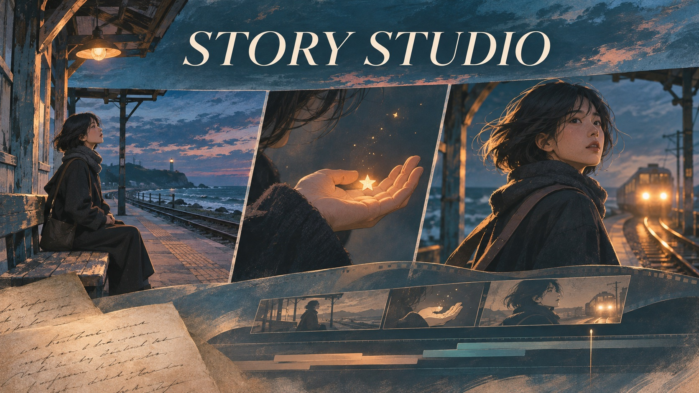

# Story Studio



이야기를 만화와 영상으로 발전시키는 창작 워크스페이스입니다.

**Story → Comic → ShotPlan → Video**

이야기는 작품의 원본입니다. 만화는 독립적으로 읽는 콘텐츠이며, 영상은 같은 이야기를 실현하는 또 하나의 방식입니다.

[손잡고 프로젝트](https://sonjapgo.com/voyage/projects/75) · [프로토타입 열기](https://story-studio-paradigmdragon.paradigmdragon.chatgpt.site/) · [공동 작업 안내](CONTRIBUTING.md) · [FilmCraft 연결 계획](docs/filmcraft-integration.md)

## 현재 사용할 수 있는 기능

- 아이디어 또는 글을 입력해 이야기와 3~5컷 초안 구성
- 같은 인물과 세계를 담은 서로 다른 예시 이미지 3컷, 컷별 이미지 업로드
- 대사·서술·장면 의도 편집과 세로형 Comic Reader
- 브라우저 자동 저장, `.story` 작품 파일 내보내기·가져오기
- 컷에서 영상 계획 만들기: 길이·구도·움직임·소리
- 이야기·만화·영상 계획의 판 분리 및 이전 판 경고

현재는 정적 HTML/CSS/JavaScript 프로토타입입니다. 글을 컷으로 나누는 과정은 로컬 규칙에 따른 초안 구성이며 실시간 AI 이미지·영상 생성은 연결되어 있지 않습니다. 작품은 현재 브라우저에 저장되며 계정 간 공동 편집·클라우드 저장은 아직 없습니다.

## 시작하기

Node.js 22 이상과 Python 3이 필요합니다. 외부 패키지를 설치할 필요는 없습니다.

```sh
git clone https://github.com/paradigmdragon/story-studio.git
cd story-studio
npm run check
npm run dev
```

브라우저에서 <http://127.0.0.1:4317>을 엽니다. 종료하려면 터미널에서 Ctrl+C를 누릅니다.

## 소스 구조

| 경로 | 역할 |
| --- | --- |
| `dist/index.html` | 화면의 기본 구조 |
| `dist/app.js` | 작품 모델·편집·저장·Reader·영상 계획 |
| `dist/style.css` | 반응형 레이아웃과 시각 디자인 |
| `dist/*.jpg` | 예시 만화 이미지 |
| `.openai/hosting.json` | 기존 Sites 프로젝트와 정적 배포 경로 |
| `scripts/check-source.mjs` | 필수 자산·HTML 참조·호스팅 설정 검사 |

빌드 과정이 없어 `dist/`가 직접 수정하는 소스입니다. 구조 정리를 이유로 기존 데이터 계약을 바꾸지 않습니다.

## 다음 목표: 손잡고 · FilmCraft 연결

Story Studio의 컷·대사·길이를 편집안으로 확인한 뒤, 기존 손잡고앱 실행 경로를 통해 FilmCraft의 자막·러프컷 작업으로 이어갑니다.

2026-11-03 연결 조회에서 FilmCraft의 명령 목록과 자막 관련 명령을 확인했습니다. 현재 공개된 연결은 조회 전용입니다. Site에서 자막·러프컷을 실행하는 연동은 아직 구현·검증되지 않았습니다. 필요한 실행 계약과 Sites 앱 연동 허용 여부를 먼저 확인합니다.

## 협업과 배포

GitHub는 코드·Issue·PR·검사를, 손잡고 프로젝트는 목표·분담·현재 지시·진행 결과를 관리합니다. 이 프로젝트는 P67/T214에 소속되지 않는 독립 프로젝트입니다.

현재 Site의 2판 소스를 이어받았습니다. 원본 Sites 커밋은 `aa20bf5ae057679ba30041b4400b12185c296c70`입니다. GitHub에 push하거나 PR을 병합해도 현재 Site로 자동 배포되지 않습니다. 실제 배포는 기존 Sites의 승인된 소스 동기화·저장·배포 절차로 수행합니다.

## 라이선스

저장소 생성 시 선택된 [Apache License 2.0](LICENSE)을 유지합니다. 사용자 작품·원고·개인 미디어는 저장소에 커밋하지 않습니다.
